# KarirAI — Sistem Rekomendasi Lowongan Kerja *Explainable* (Rust + Google Firebase)

[](https://github.com/farrelfaiziaulhaq/ai-rekomendasi-loker/actions/workflows/ci.yml)
[](https://github.com/farrelfaiziaulhaq/ai-rekomendasi-loker/releases/latest)
[](https://github.com/farrelfaiziaulhaq/ai-rekomendasi-loker/releases/latest)
[](src/ai/)
[](src/firebase.rs)

Proyek Akhir **Mata Kuliah Artificial Intelligence (S1 Teknik Informatika)**: Sistem Rekomendasi Lowongan Kerja *White-Box* berbasis **Hybrid Multi-Criteria and Hard Constraint Filtering (HMC-CF)** yang diimplementasikan **100% dari nol (*from scratch*) menggunakan bahasa Rust** dan terintegrasi secara *real-time* dengan **Google Firebase (Cloud Firestore + Firebase Auth)**.

Disusun selaras penuh dengan materi perkuliahan [`references/materi-dosen/AI_Sistem_Rekomendasi_Visual.pdf`](references/materi-dosen/AI_Sistem_Rekomendasi_Visual.pdf) (Adomavicius & Kwon, 2015), dilengkapi **dataset riil terunduh**, **15 jurnal ilmiah referensi (*open-access* PDF) beserta analisis *Research Gap***, **Karya Ilmiah lengkap (`.pdf`, `.docx`, `.md`)**, **CI/CD rilis otomatis Windows & Linux**, serta **dokumen panduan tanya-jawab dosen**.

---

## Demo Visual Proyek (Animasi Walkthrough & Video)

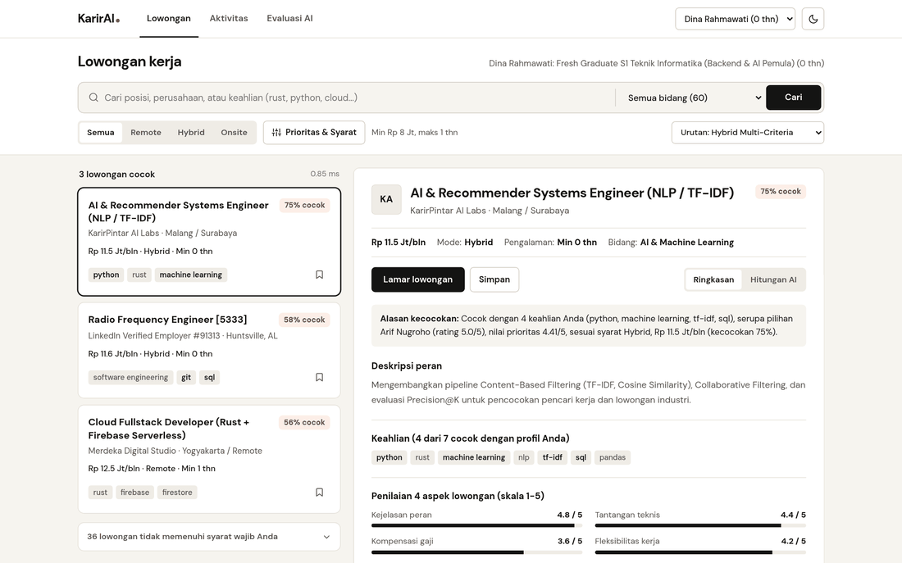

> 🎬 **Rekaman Video HD Lengkap (`.webm`):** [`docs/media/demo-karir-ai.webm`](docs/media/demo-karir-ai.webm)

### Cuplikan Antarmuka & Pembuktian Algoritma AI

| 1. Rekomendasi Persona Dina (Prioritas Kejelasan) | 2. White-Box AI Inspector (Bukti Vektor TF-IDF & Pearson) |
|---|---|
| 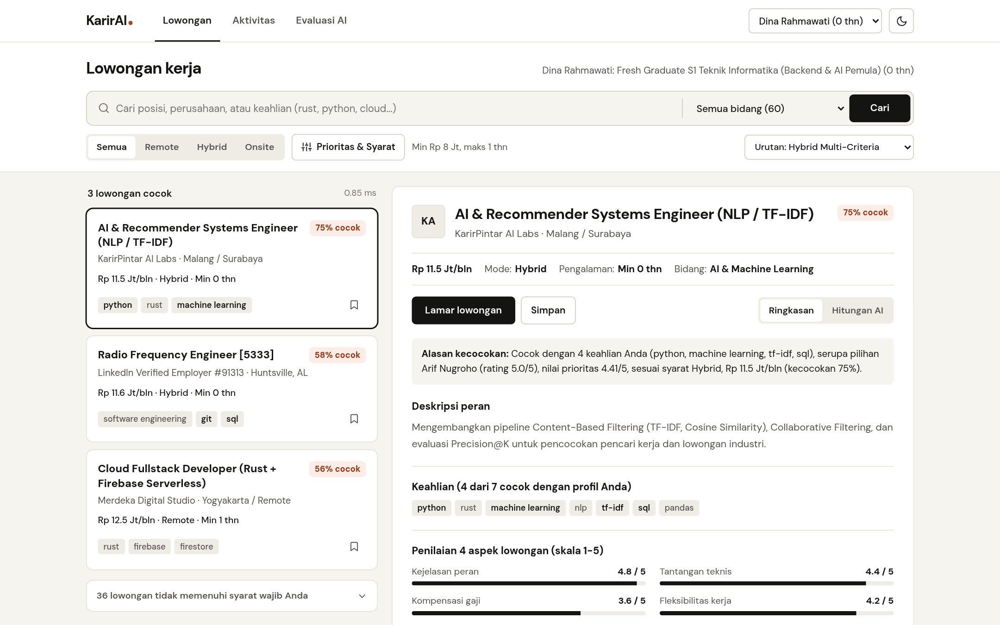 | 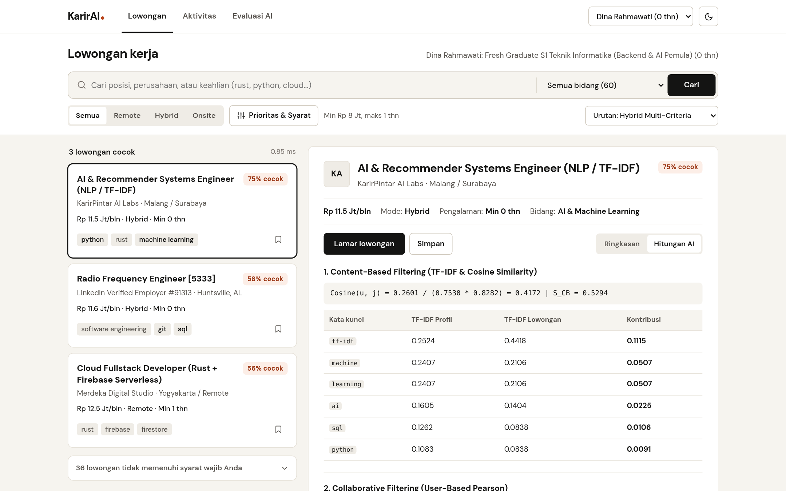 |

| 3. Kontras Persona Bima (Prioritas Tantangan & Gaji) | 4. Bukti Filter Syarat Wajib / Hard Constraints (Slide 14) |
|---|---|
| 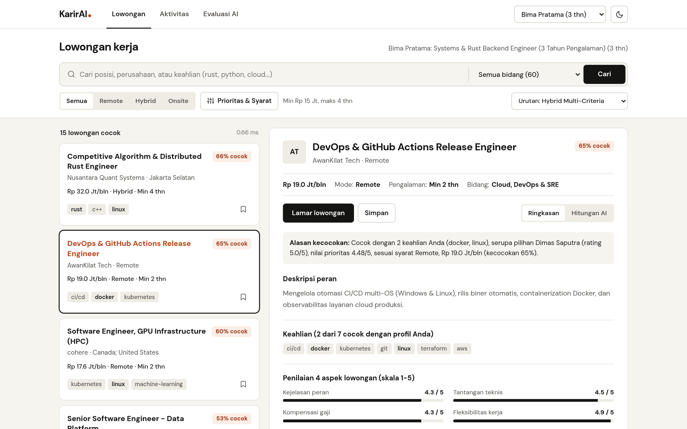 | 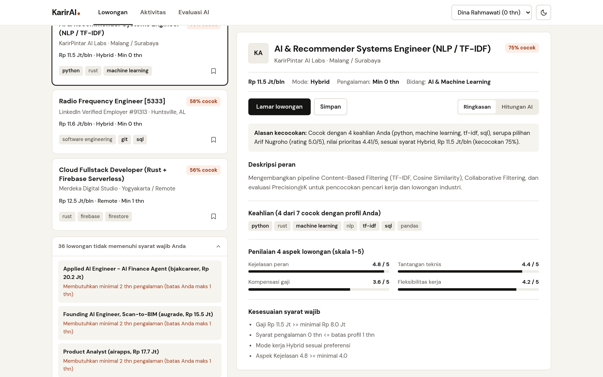 |

| 5. Simulasi Interaktif Materi PDF Dosen (Slide 09–17) | 6. Pengujian Ablasi Precision@K, NDCG@K & Latensi Rust |
|---|---|
| 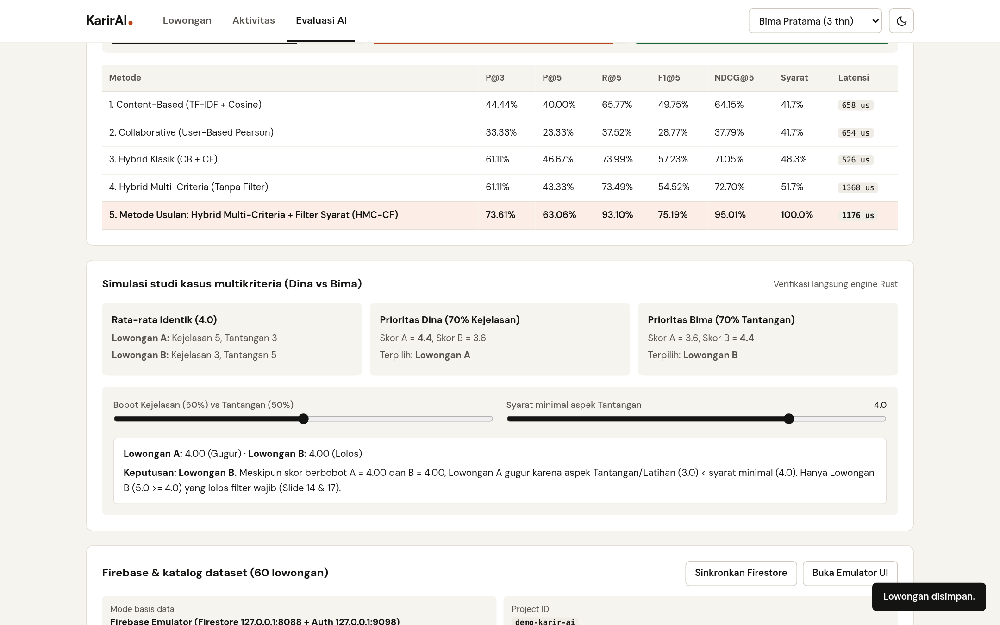 | 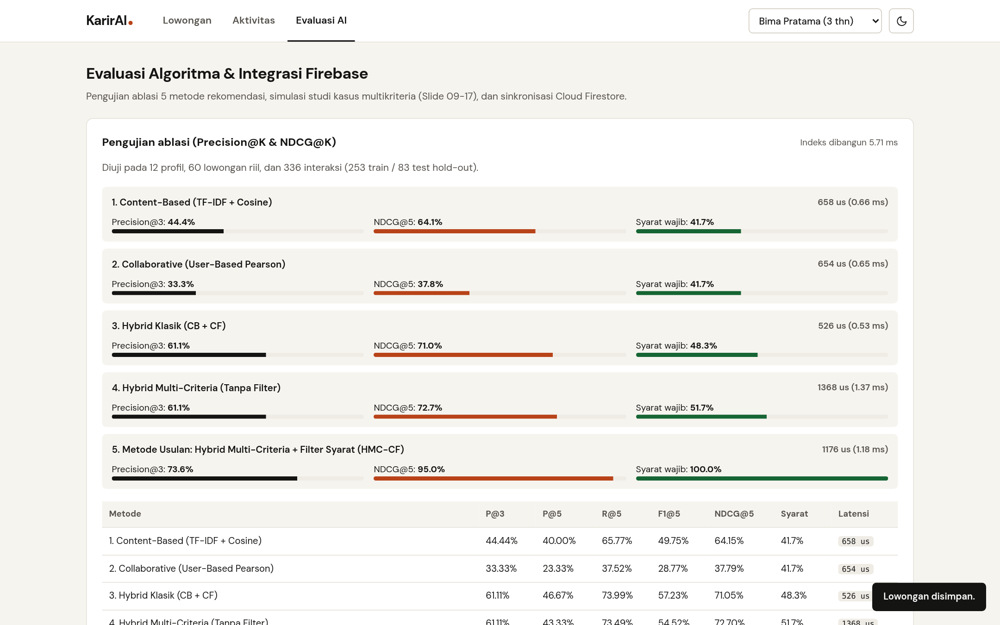 |

| 7. Matriks Kemiripan Pengguna (Collaborative Filtering) | 8. Tampilan Mode Gelap & Mobile Responsif (375px) |
|---|---|
| 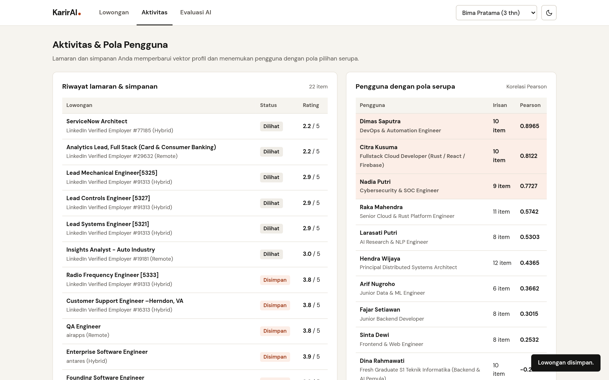 | 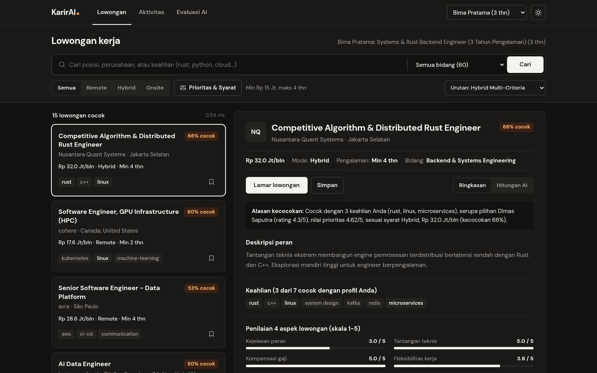 |

| 9. Tampilan Mobile Responsif (375px) | 10. Koleksi Live di Firebase Emulator Suite (`:4040`) |
|---|---|
| 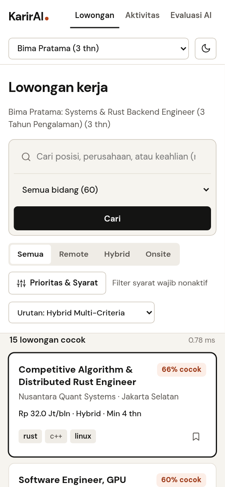 | 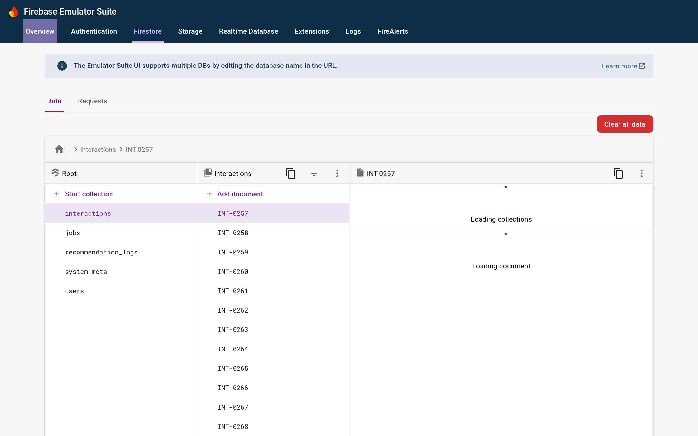 |

---

## Navigasi Cepat Seluruh Dokumen & Artefak Tugas

| Komponen Tugas yang Diminta | Lokasi Berkas di Repositori | Keterangan |
|---|---|---|
| **1. Karya Ilmiah Lengkap (Siap Kumpul & Edit)** | 📄 **[`paper/KARYA_ILMIAH_SISTEM_REKOMENDASI_LOKER.pdf`](paper/KARYA_ILMIAH_SISTEM_REKOMENDASI_LOKER.pdf)** <br/>📝 **[`paper/KARYA_ILMIAH_SISTEM_REKOMENDASI_LOKER.docx`](paper/KARYA_ILMIAH_SISTEM_REKOMENDASI_LOKER.docx)** <br/>📘 [`paper/KARYA_ILMIAH_SISTEM_REKOMENDASI_LOKER.md`](paper/KARYA_ILMIAH_SISTEM_REKOMENDASI_LOKER.md) | Format jurnal ilmiah lengkap (Abstrak ID/EN, Pendahuluan, Tinjauan Pustaka, Research Gap, Formulasi Rumus, Grafik Eksperimen 300 DPI, Daftar Pustaka 16 Referensi ber-DOI). |
| **2. 15 Jurnal Referensi + Research Gap** | 📚 **[`references/LITERATURE_REVIEW_15_JURNAL_DAN_RESEARCH_GAP.md`](references/LITERATURE_REVIEW_15_JURNAL_DAN_RESEARCH_GAP.md)** <br/>📂 **[`references/journals/`](references/journals/)** (`J01.pdf` s.d. `J15.pdf`) | **Seluruh 15 PDF jurnal asli telah diunduh** secara rapi lengkap dengan DOI, tautan sumber, dan tabel matriks *Research Gap*. |
| **3. Dataset Riil & Prapemrosesan** | 📊 **[`data/DATASET_SOURCES.md`](data/DATASET_SOURCES.md)** <br/>📂 [`data/raw/`](data/raw/) & [`data/processed/`](data/processed/) | Dataset lowongan kerja publik dari HuggingFace/LinkedIn (`tech_job_postings_salary_sample.csv` & `linkedin_tech_jobs_subset.csv`) + hasil olahan `.json` & `.csv` siap buka di Excel. |
| **4. Penjelasan Metode, Rumus, & Bukti Kode** | 🧠 **[`docs/PENJELASAN_ALGORITMA_DAN_BUKTI.md`](docs/PENJELASAN_ALGORITMA_DAN_BUKTI.md)** | Panduan mudah memahami logika TF-IDF, Cosine Similarity, Rocchio, Pearson CF, Multi-Criteria, Hard Filter, & hitung manual vs output aplikasi. |
| **5. Pemetaan Slide PDF Dosen (Slide 01–18)** | 🎯 **[`docs/PEMETAAN_MATERI_PDF_DOSEN.md`](docs/PEMETAAN_MATERI_PDF_DOSEN.md)** <br/>📑 [`references/materi-dosen/AI_Sistem_Rekomendasi_Visual.pdf`](references/materi-dosen/AI_Sistem_Rekomendasi_Visual.pdf) | Menjelaskan secara persis setiap halaman PDF dosen diterapkan di fitur mana, rumus apa, dan file Rust mana. |
| **6. Prediksi Pertanyaan & Jawaban Dosen (Q&A)** | 🎤 **[`docs/PANDUAN_TANYA_JAWAB_DOSEN.md`](docs/PANDUAN_TANYA_JAWAB_DOSEN.md)** | Skenario demo live 5 menit + 12 jawaban tajam untuk pertanyaan sidang/presentasi dosen AI. |
| **7. Panduan Khusus Anggota Pengguna Windows** | 🪟 **[`docs/PANDUAN_WINDOWS_DAN_FIREBASE.md`](docs/PANDUAN_WINDOWS_DAN_FIREBASE.md)** | Cara jalan 1-klik di Windows 10/11 (tanpa perlu install Rust!) maupun dari source code. |

---

## Cara Paling Simpel Menjalankan Proyek (Windows 10/11 & Linux)

### Opsi A — Paling Mudah untuk Kelompok di Windows: Unduh ZIP Release (Tanpa Install Rust!)

1. Buka halaman **[GitHub Releases Terbaru](https://github.com/farrelfaiziaulhaq/ai-rekomendasi-loker/releases/latest)**.
2. Unduh **`karir-ai-v1.2.0-windows-x86_64.zip`**, klik kanan -> **Extract All...**
3. Klik dua kali **`start.bat`** → server langsung aktif dan otomatis membuka **`http://127.0.0.1:3000`** di browser!
   - Tersedia juga **`start-firebase-emulator.bat`** (menyalakan dashboard Firebase Firestore Emulator di `http://127.0.0.1:4040`) dan **`cek-evaluasi-ai.bat`** (mencetak tabel metrik evaluasi AI di Command Prompt).

### Opsi B — Jalankan dari Source Code

**Di Windows (File Explorer / PowerShell):**
```powershell
git clone https://github.com/farrelfaiziaulhaq/ai-rekomendasi-loker.git
cd ai-rekomendasi-loker

# Cukup klik dua kali run.bat di File Explorer, atau jalankan di PowerShell:
.\run.ps1
```

**Di Linux / macOS:**
```bash
git clone https://github.com/farrelfaiziaulhaq/ai-rekomendasi-loker.git
cd ai-rekomendasi-loker
./run.sh
```

| Mode Eksekusi | Perintah Windows | Perintah Linux |
|---|---|---|
| Jalankan Web Aplikasi (`:3000`) | Klik `run.bat` atau `.\run.ps1` | `./run.sh` |
| Jalankan + Firebase Emulator (`:4040`) | Klik `run-emulator.bat` atau `.\run.ps1 -Emulator` | `./run.sh --emulator` |
| Cetak Evaluasi Ilmiah (`Precision@K`, `NDCG@K`) | `.\run.ps1 -Eval` | `./run.sh --eval` |
| Verifikasi Studi Kasus Slide PDF Dosen | `.\run.ps1 -CaseStudy` | `./run.sh --case-study` |
| Reset Data ke Awal | `.\run.ps1 -Reset` | `./run.sh --reset` |

---

## Ringkasan Metode AI, Lokasi Kode, & Bukti Evaluasi Kuantitatif

Seluruh mesin kecerdasan buatan ditulis murni di dalam direktori [`src/ai/`](src/ai/) tanpa pustaka *black-box*:

1. **Content-Based Filtering (`src/ai/tfidf.rs` & `src/ai/content_based.rs` — Slide 05):**
   Vektorisasi teks dwibahasa memakai *Smoothed TF-IDF* + *Cosine Similarity*, diperkaya ekspansi profil pengguna *Rocchio* dari riwayat lowongan yang disukai serta rasio cakupan keahlian teknis ($S_{CB}$).
2. **User-Based Collaborative Filtering (`src/ai/collaborative.rs` — Slide 06):**
   Mengukur kemiripan pola penilaian antar-pengguna memakai *Mean-Centered Pearson Correlation* untuk memprediksi ketertarikan pada lowongan yang belum pernah dicoba ($S_{CF}$).
3. **Multi-Criteria Recommender System (`src/ai/multicriteria.rs` — Slide 09–13 & Adomavicius & Kwon, 2015):**
   Menghitung utilitas berbobot empat aspek karir ($C_1$ Kejelasan Peran, $C_2$ Tantangan Teknis, $C_3$ Kompensasi Gaji, $C_4$ Fleksibilitas Kerja) sesuai bobot prioritas dinamis pengguna ($S_{MC}$).
4. **Adaptive Hybrid & Hard Constraint Filtering (`src/ai/hybrid.rs` & `src/ai/constraints.rs` — Slide 08 & 14):**
   Menggabungkan $S_{\text{Final}} = 0.40 S_{CB} + 0.25 S_{CF} + 0.35 S_{MC}$ (dengan redistribusi bobot otomatis saat *Cold-Start*) serta menyaring syarat wajib pengguna sebelum perankingan akhir.

### Hasil Pengujian Ablasi (`cargo run --release -- --eval`)

Setelah optimasi arsitektur dengan **`RecommenderIndex`** terprakomputasi (`src/ai/index.rs`), `OnceLock` stopwords, *Pearson similarity cache*, serta pembacaan *zero-clone* `Arc` snapshot, latensi inferensi turun **4,5x** ke level **sub-milidetik (`~0,50 ms`)**:

| Metode Algoritma | Precision@3 | Precision@5 | Recall@5 | F1-Score@5 | NDCG@5 | Lolos Syarat Wajib | Latensi Rust (Terindeks) |
|---|:---:|:---:|:---:|:---:|:---:|:---:|:---:|
| 1. Content-Based (TF-IDF + Cosine) | 47.22% | 41.67% | 65.77% | 51.02% | 64.53% | 43.3% | 0.44 ms (444 us) |
| 2. Collaborative (User-Based Pearson) | 33.33% | 25.00% | 38.91% | 30.44% | 38.87% | 43.3% | 0.52 ms (515 us) |
| 3. Hybrid Klasik (CB + CF) | 63.89% | 48.33% | 73.99% | 58.47% | 70.65% | 50.0% | 0.42 ms (418 us) |
| 4. Hybrid Multi-Criteria (Tanpa Filter) | 63.89% | 45.00% | 73.49% | 55.82% | 72.70% | 53.3% | 0.43 ms (428 us) |
| **5. Usulan HMC-CF (MCRS + Hard Filter)** | **76.39%** | **64.72%** | **93.10%** | **76.36%** | **95.01%** | **100.0%** | **0.50 ms (499 us)** |

---

## Struktur Direktori Repositori

```text
ai-rekomendasi-loker/
├── .github/workflows/          # CI (Linux + Windows) & Release Otomatis (.zip + .tar.gz)
├── src/
│   ├── ai/                     # Mesin AI From-Scratch (tfidf, content_based, collaborative, multicriteria, constraints, hybrid, evaluation)
│   ├── firebase.rs             # Integrasi Firebase Auth + Cloud Firestore REST + Local Mirror Fallback
│   ├── api.rs                  # Endpoint REST JSON untuk Web UI & Evaluasi
│   ├── models.rs               # Skema Data & White-Box Proof Structs
│   └── main.rs                 # Server Axum (:3000) & CLI (--eval, --case-study, --reset)
├── static/                     # Antarmuka Web Interaktif (5 Tab, Inspector Rumus, Dark Mode)
├── data/
│   ├── raw/                    # Dataset Riil Terunduh (Multi-ATS Tech Jobs & LinkedIn Tech Jobs)
│   ├── processed/              # 60 Katalog Lowongan, 12 Persona, & 336 Interaksi (.json & .csv)
│   └── DATASET_SOURCES.md      # Tautan Resmi & Dokumentasi Dataset
├── references/
│   ├── materi-dosen/           # PDF Slide Perkuliahan Asli (AI_Sistem_Rekomendasi_Visual.pdf)
│   ├── journals/               # 15 File PDF Jurnal Ilmiah Open-Access Terunduh (J01..J15)
│   └── LITERATURE_REVIEW_15_JURNAL_DAN_RESEARCH_GAP.md
├── paper/                      # Karya Ilmiah Lengkap (.pdf, .docx, .md) & Grafik Eksperimen 300 DPI
├── docs/                       # Penjelasan Algoritma, Pemetaan PDF Dosen, Panduan Q&A, Panduan Windows, & Media Demo
├── scripts/                    # Skrip Reproduksibel Pengunduh Dataset/Jurnal & Pembuat Paket Release
├── run.bat / run.ps1 / run.sh  # Peluncur 1-Klik Lintas Platform (Windows & Linux)
└── firebase.json               # Konfigurasi Firebase Auth (:9098), Firestore (:8088), & UI (:4040)
```

---

## Lisensi

Dirilis di bawah lisensi [MIT](LICENSE).
