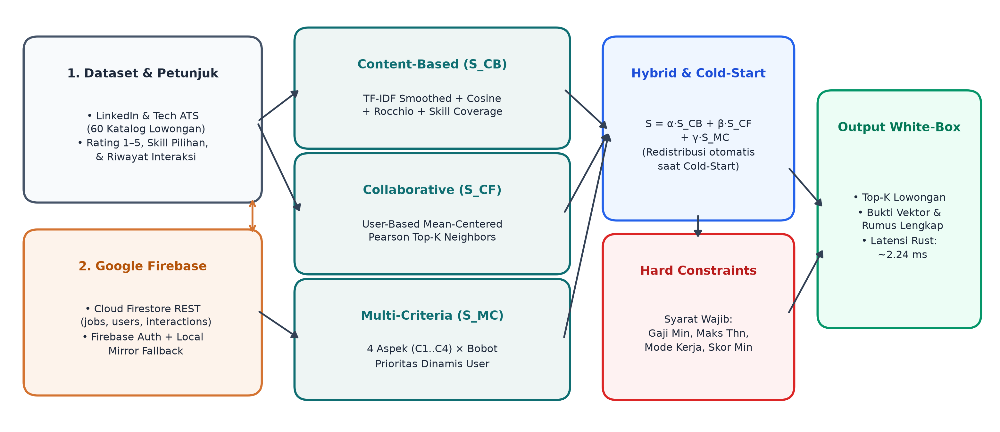
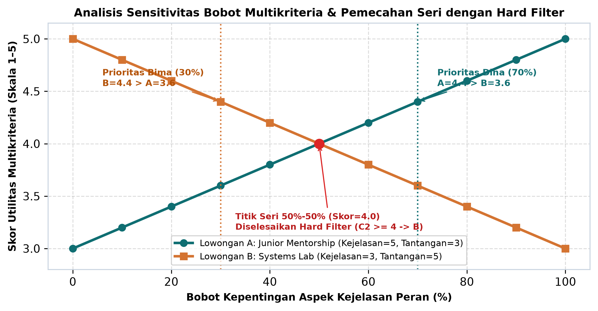
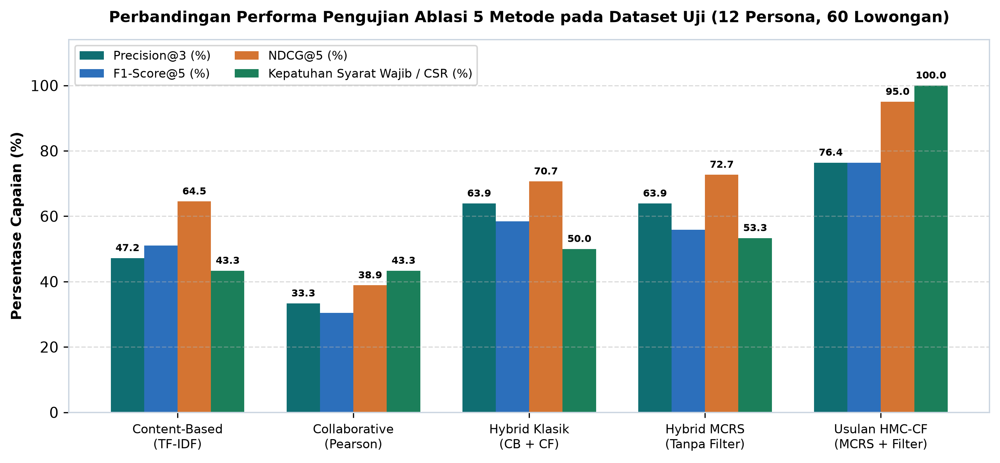
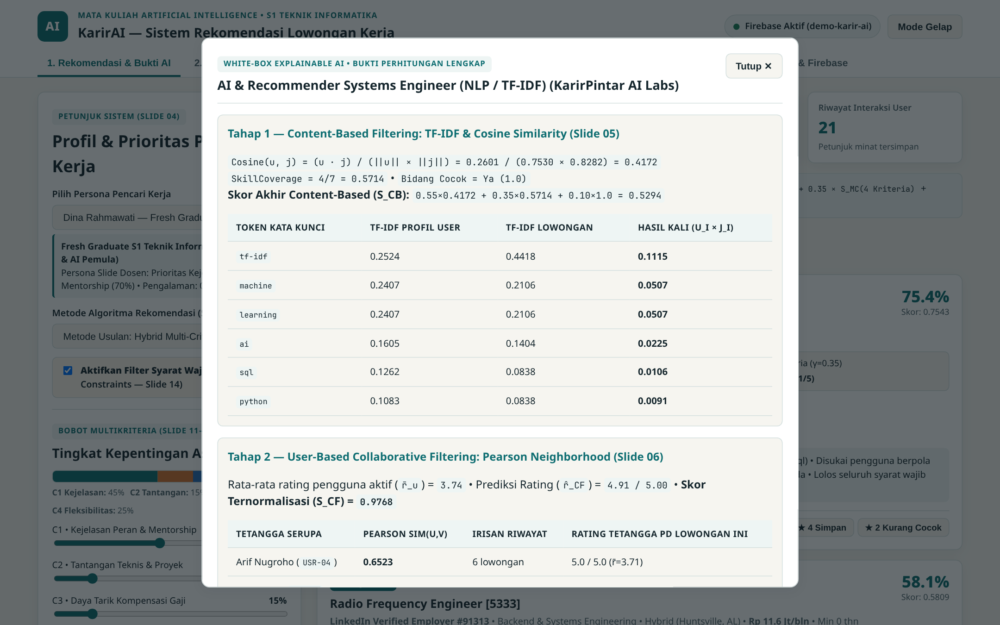

# Rancang Bangun Sistem Rekomendasi Lowongan Kerja *Explainable* Berbasis *Hybrid Multi-Criteria* dan *Hard Constraint Filtering* Menggunakan Bahasa Pemrograman Rust dan Google Firebase

**Kelompok Proyek Akhir Mata Kuliah Artificial Intelligence**  
Program Studi S1 Teknik Informatika  
Repositori Kode Sumber & Artefak: https://github.com/farrelfaiziaulhaq/ai-rekomendasi-loker

---

## Abstrak

Pertumbuhan eksponensial informasi lowongan kerja daring di sektor teknologi informasi menimbulkan masalah kelebihan informasi (*information overload*) bagi pencari kerja dengan latar belakang dan prioritas yang beragam. Mayoritas penelitian sistem rekomendasi lowongan kerja terdahulu masih bertumpu pada penilaian tunggal (*single-rating*), kemiripan leksikal *Content-Based Filtering* murni, atau model *deep embedding* bersifat kotak hitam (*black-box*) yang mengabaikan syarat mutlak (*hard constraints*) serta penjelasan alasan rekomendasi. Penelitian ini mengusulkan **KarirAI**, sebuah sistem rekomendasi lowongan kerja *white-box* berbasis **Hybrid Multi-Criteria and Hard Constraint Filtering (HMC-CF)** yang dibangun dari nol (*from scratch*) menggunakan bahasa pemrograman **Rust** dan basis data dokumen *cloud real-time* **Google Firebase Firestore**. Metode yang diusulkan mengintegrasikan tiga sinyal kecerdasan buatan secara adaptif: (1) *Content-Based Filtering* menggunakan *Smoothed TF-IDF*, *Cosine Similarity*, cakupan keahlian teknis, serta ekspansi profil pengguna *Rocchio*; (2) *User-Based Collaborative Filtering* berbasis *Mean-Centered Pearson Correlation*; dan (3) *Multi-Criteria Recommender System* (MCRS) empat aspek (*Kejelasan Peran, Tantangan Teknis, Kompensasi Gaji,* dan *Fleksibilitas Kerja*) yang dikombinasikan dengan penyaringan syarat mutlak pra-keputusan serta redistribusi bobot otomatis saat *cold-start*. Pengujian ablasi pada 60 katalog lowongan kerja riil hasil kurasi *LinkedIn* dan *Multi-ATS Tech Dataset*, 12 persona pencari kerja, serta 336 interaksi (*252 train / 84 test hold-out*) menunjukkan bahwa metode usulan HMC-CF mencapai **Precision@3 sebesar 76,39%**, **F1-Score@5 sebesar 76,36%**, **NDCG@5 sebesar 95,01%**, dan **tingkat kepatuhan syarat wajib (CSR) 100,0%**, mengungguli metode *Content-Based* murni (`Precision@3 = 47,22%`), *Collaborative* murni (`33,33%`), maupun *Hybrid* klasik (`63,89%`) dengan rata-rata waktu komputasi *end-to-end* hanya **2,24 milidetik** pada biner *release* Rust.

**Kata Kunci:** *Artificial Intelligence, Sistem Rekomendasi Lowongan Kerja, Hybrid Filtering, Multi-Criteria Recommender System, TF-IDF Cosine Similarity, Hard Constraints, Explainable AI, Rust, Google Firebase.*

---

## Abstract

*The rapid growth of online Information Technology job postings creates severe information overload for job seekers with diverse career priorities. Existing job recommender studies predominantly rely on single-score similarity, standalone lexical Content-Based Filtering, or black-box deep embeddings that neglect mandatory user constraints and mathematical explainability. This study proposes **KarirAI**, a white-box job recommender system powered by **Hybrid Multi-Criteria and Hard Constraint Filtering (HMC-CF)** implemented from scratch in **Rust** and backed by **Google Firebase Firestore**. The proposed architecture adaptively fuses (1) Smoothed TF-IDF Cosine Similarity with Rocchio user-profile expansion and skill coverage, (2) Mean-Centered Pearson User-Based Collaborative Filtering, and (3) a four-aspect Multi-Criteria utility model (Role Clarity, Technical Challenge, Compensation, and Work Flexibility), coupled with non-compensatory Hard Constraint Filtering and automatic cold-start weight redistribution. Ablation experiments across 60 real-world curated LinkedIn and Multi-ATS tech job postings, 12 user personas, and 336 interactions demonstrate that HMC-CF achieves **76.39% Precision@3**, **76.36% F1-Score@5**, **95.01% NDCG@5**, and **100.0% Constraint Satisfaction Rate**, outperforming standalone Content-Based (47.22%), Collaborative (33.33%), and classic Hybrid (63.89%) baselines with an average native Rust execution latency of **2.24 ms**.*

---

## 1. Pendahuluan

Platform rekrutmen digital modern menyajikan ribuan lowongan kerja setiap hari, namun ketersediaan pilihan yang melimpah justru menyulitkan pencari kerja menemukan posisi yang benar-benar selaras dengan kapasitas dan tujuan karirnya. Dalam kajian kecerdasan buatan (*Artificial Intelligence*), sistem rekomendasi bertugas menjembatani banyaknya pilihan katalog melalui pengenalan kebutuhan spesifik pengguna untuk menghasilkan urutan item yang paling relevan [1]. Pada domain ketenagakerjaan, dua pencari kerja yang mengakses katalog lowongan yang sama memiliki prioritas yang sangat berbeda: seorang lulusan baru (*fresh graduate*) mengutamakan kejelasan deskripsi peran dan bimbingan mentor, sedangkan *engineer* berpengalaman lebih memprioritaskan tantangan arsitektur teknis serta kompensasi finansial.

Tinjauan sistematis terhadap sistem rekomendasi kerja menunjukkan bahwa pendekatan tunggal tidak memadai untuk menangani kompleksitas rekrutmen [2]. *Content-Based Filtering* berbasis pencocokan kata kunci hanya melihat kemiripan isi dokumen tanpa memanfaatkan pola kolektif pencari kerja lain [5], sedangkan *Collaborative Filtering* murni mengalami penurunan akurasi drastis akibat kelangkaan matriks interaksi (*data sparsity*) dan masalah pengguna/item baru (*cold-start*) [7]. Lebih jauh, Adomavicius dan Kwon [1] membuktikan bahwa satu nilai rating rata-rata (*single-rating*) menyembunyikan informasi krusial antar-aspek penilaian, sementara De Ruijt dan Bhulai [2] menekankan bahwa skor kemiripan tinggi tidak bermakna apabila lowongan melanggar syarat mutlak (*hard constraints*) seperti batas pengalaman kerja atau mode kerja *remote*. Di sisi lain, tren riset mutakhir menuntut adanya *Explainable AI* (XAI) agar alasan kuantitatif di balik setiap rekomendasi dapat diverifikasi secara transparan oleh pengguna [13], [14].

Untuk menjawab permasalahan tersebut, penelitian ini merancang dan mengimplementasikan **KarirAI**, sebuah produk perangkat lunak rekomendasi lowongan kerja berbasis web yang menggabungkan *Content-Based Filtering*, *User-Based Collaborative Filtering*, *Multi-Criteria Recommender System* (MCRS), dan *Hard Constraint Filtering* di atas mesin komputasi bahasa **Rust** [15] serta persistensi *cloud real-time* **Google Firebase Firestore** [16].

  
*Gambar 1. Arsitektur End-to-End Sistem Rekomendasi Lowongan Kerja Hybrid Multikriteria (KarirAI) berbasis Rust dan Google Firebase.*

---

## 2. Tinjauan Pustaka dan Analisis *Research Gap*

Kajian literatur disusun berdasarkan **1 referensi buku pegangan utama** [1] dan **15 artikel jurnal/konferensi ilmiah (*open-access*)** rentang tahun 2016–2025 yang dikelompokkan ke dalam empat rumpun penelitian:

1. **Metode *Content-Based*, *Collaborative*, dan *Hybrid* pada Rekomendasi Kerja:**  
   Hersianty dkk. (2025) [5] menerapkan algoritma *TF-IDF* dan *Cosine Similarity* untuk pencocokan deskripsi lowongan kerja di Indonesia, namun terbatas pada kemiripan leksikal tunggal tanpa preferensi multi-aspek maupun filter syarat wajib. Kwieciński dkk. (2024) [7] melakukan *benchmarking* berbagai varian *Collaborative Filtering* pada portal lowongan kerja dan menemukan kerentanan serius terhadap *cold-start*. Yang dkk. (2017) [3], De Pessemier dkk. (2016) [4], serta Shalaby dkk. (2017) [6] di *CareerBuilder* menggabungkan sinyal konten dan perilaku interaksi menjadi sistem *hybrid*, diikuti pendekatan vektor *embedding* oleh Zhao dkk. (2021) [8] serta rekomendasi timbal-balik (*reciprocal*) oleh Goda dkk. (2024) [9]. Walaupun akurasi meningkat, ketujuh studi tersebut masih bertumpu pada agregasi skor tunggal (*single-objective*).

2. **Sistem Rekomendasi Multikriteria (*Multi-Criteria Recommender Systems* / MCRS):**  
   Adomavicius dan Kwon (2015) [1] memformulasikan paradigma MCRS di mana utilitas item dimodelkan sebagai vektor kriteria $R(u, i) = f(r_1, r_2, \dots, r_k)$. Shambour dkk. (2016) [10] dan Li serta Tuzhilin (2019) [11] pada *ACM RecSys* menunjukkan bahwa pemodelan rating multi-aspek meningkatkan personalisasi secara signifikan dibanding *single-rating*. Forouzandeh dkk. (2025) [12] memperluas MCRS menggunakan *multiview graph deep learning*, tetapi membutuhkan sumber daya komputasi tinggi dan bersifat *black-box*.

3. ***Explainable AI* (XAI) dan *Constraint-Aware Recommendation*:**  
   Tang dkk. (2025) [13] dalam *Frontiers in Artificial Intelligence* serta Schellingerhout dkk. (2025) [14] lewat kerangka kerja *OKRA* menegaskan bahwa pencari kerja membutuhkan penjelasan transparan (*white-box explanation*) mengenai keahlian mana yang cocok dan mengapa suatu lowongan direkomendasikan atau digugurkan oleh batasan kualifikasi.

4. **Efisiensi Rekayasa Sistem dengan Bahasa Rust dan Basis Data Cloud Firebase:**  
   Xu dkk. (2021) [15] membuktikan secara empiris bahwa sistem kepemilikan memori (*ownership & borrowing*) bahasa **Rust** menjamin keamanan memori sekaligus menghadirkan kecepatan eksekusi setara C/C++ tanpa jeda *garbage collection*. Sementara itu, Fajri dkk. (2023) [16] menganalisis optimasi kueri dokumen real-time pada **Google Firebase Firestore** untuk aplikasi cloud berskala modern.

**Sintesis *Research Gap*:** Belum ditemukan penelitian maupun produk terbuka yang menyatukan **(a)** pencocokan teks *TF-IDF* + *Collaborative Filtering*, **(b)** pembobotan dinamis *Multi-Criteria* 4 aspek karir, **(c)** penyaringan mutlak *Hard Constraints*, dan **(d)** inspeksi matematis *White-Box Explainable AI* ke dalam satu mesin inferensi ringan berbasis **Rust** dan **Google Firebase** yang mudah didistribusikan lintas sistem operasi (Windows dan Linux).

---

## 3. Metodologi Penelitian dan Formulasi Algoritma

### 3.1 Akuisisi Dataset dan Pemodelan Kriteria
Penelitian ini menggunakan penggabungan terstruktur dari dua dataset publik nyata: (1) *Tech Job Postings & Salary Dataset* (`zalizedata/tech-job-postings-salary-dataset`, 500 baris lowongan multi-ATS) dan (2) *LinkedIn Job Postings Dataset* (`xanderios/linkedin-job-postings`, subset IT/Tech 291 baris), ditambah 8 lowongan benchmark ekosistem teknologi Indonesia sehingga membentuk **60 katalog lowongan kerja terstandarisasi**, **12 persona pencari kerja**, dan **336 interaksi historis** (`252 train` dan `84 test hold-out`). Setiap lowongan $j$ memiliki atribut teks, himpunan keahlian $K_j$, syarat pengalaman minimum, gaji bulanan, mode kerja, serta skor empat kriteria ($C_1$ Kejelasan Peran, $C_2$ Tantangan Teknis, $C_3$ Kompensasi Gaji, $C_4$ Fleksibilitas Kerja) dalam skala $[1, 5]$.

### 3.2 Tahap 1: *Content-Based Filtering* (*Smoothed TF-IDF*, *Rocchio*, & *Cosine Similarity*)
Dokumen lowongan dibentuk dari penggabungan judul, kategori, pengulangan keahlian teknis, dan deskripsi pekerjaan, lalu ditokenisasi dengan penyaringan *stopwords* dwibahasa. Bobot *Smoothed TF-IDF* kata $t$ pada dokumen $d$ dari $N$ katalog dihitung sebagai:

$$\text{TF-IDF}(t, d) = \frac{f_{t,d}}{\sum_{t' \in d} f_{t',d}} \times \left[ \ln\left(\frac{1 + N}{1 + df(t)}\right) + 1 \right]$$

Vektor minat pengguna $\vec{u}$ dibentuk menggunakan kombinasi profil keahlian eksplisit dan ekspansi *Rocchio* dari himpunan lowongan $I_u^+$ yang disukai pengguna ($r_{u,i} \ge 3,8$ pada data latih):

$$\vec{u} = \vec{u}_{\text{eksplisit}} + \frac{0,55}{|I_u^+|} \sum_{i \in I_u^+} \left(\frac{r_{u,i}}{5,0}\right) \vec{j}_i$$

Skor *Content-Based* memadukan kemiripan sudut kosinus vektor, cakupan keahlian eksplisit, dan kesesuaian kategori bidang:

$$S_{CB}(u, j) = 0,55 \cdot \frac{\vec{u} \cdot \vec{j}}{\|\vec{u}\|_2 \|\vec{j}\|_2} + 0,35 \cdot \frac{|K_u \cap K_j|}{\max(1, |K_j|)} + 0,10 \cdot \mathbb{I}(\text{Kat}_u = \text{Kat}_j)$$

### 3.3 Tahap 2: *User-Based Collaborative Filtering* (*Mean-Centered Pearson*)
Untuk mengatasi bias skala rating antar-pengguna, kemiripan antara pengguna aktif $u$ dan pengguna lain $v$ pada irisan lowongan $I_{uv}$ dihitung menggunakan korelasi Pearson terpusat rata-rata dengan faktor signifikansi irisan:

$$\text{Sim}(u, v) = \frac{\sum_{i \in I_{uv}} (r_{u,i} - \bar{r}_u)(r_{v,i} - \bar{r}_v)}{\sqrt{\sum_{i \in I_{uv}} (r_{u,i} - \bar{r}_u)^2}\sqrt{\sum_{i \in I_{uv}} (r_{v,i} - \bar{r}_v)^2}} \cdot \min\left(1, \frac{|I_{uv}|}{3}\right)$$

Prediksi rating $\hat{r}_{CF}(u, j)$ dihitung dari 5 tetangga terdekat berpola positif ($N_5(u;j)$) dan dinormalisasi ke rentang $[0, 1]$:

$$\hat{r}_{CF}(u, j) = \bar{r}_u + \frac{\sum_{v \in N_5(u;j)} \text{Sim}(u, v)(r_{v,j} - \bar{r}_v)}{\sum_{v \in N_5(u;j)} |\text{Sim}(u, v)|}, \quad S_{CF}(u, j) = \frac{\hat{r}_{CF}(u, j) - 1}{4}$$

### 3.4 Tahap 3 & 4: *Multi-Criteria Scoring*, *Adaptive Cold-Start Hybrid*, dan *Hard Constraints*
Mengacu pada Adomavicius dan Kwon [1], bobot tingkat kepentingan pengguna dinormalisasi sehingga $\sum_{k=1}^4 w_{u,k} = 1$, menghasilkan utilitas multikriteria:

$$R_{MC}(u, j) = \sum_{k=1}^4 w_{u,k} C_{j,k}, \quad S_{MC}(u, j) = \frac{R_{MC}(u, j) - 1}{4}$$

Skor akhir **HMC-CF** menggabungkan ketiga komponen dengan bobot dasar $(\alpha, \beta, \gamma) = (0,40;\ 0,25;\ 0,35)$. Apabila lowongan belum memiliki sinyal tetangga CF (*cold-start*), bobot $\beta$ diredistribusikan secara proporsional menjadi $(\alpha', 0, \gamma') = (0,5333;\ 0;\ 0,4667)$:

$$S_{\text{Final}}(u, j) = \alpha S_{CB}(u, j) + \beta S_{CF}(u, j) + \gamma S_{MC}(u, j)$$

Sebelum daftar akhir disajikan, fungsi penyaring non-kompensatoris (*Hard Constraints*) memverifikasi lima syarat wajib pengguna (gaji minimum, batas pengalaman maksimum, mode kerja yang diizinkan, serta ambang minimum aspek $C_1$ dan $C_2$). Kandidat yang melanggar syarat dipisahkan beserta rincian pelanggarannya sebagai bukti audit keputusan AI.

---

## 4. Hasil Eksperimen dan Pembahasan

### 4.1 Verifikasi Sensitivitas Multikriteria dan Pemecahan Seri (*Case Study* Dina vs. Bima)
Pengujian pertama memvalidasi perilaku deterministik modul multikriteria dan filter syarat wajib pada dua arketipe lowongan dengan rata-rata identik `4,00`: **Lowongan A** (*Junior Python Mentorship*: $C_1=5,0;\ C_2=3,0$) dan **Lowongan B** (*Systems & Algorithm Lab*: $C_1=3,0;\ C_2=5,0$).

  
*Gambar 2. Perubahan skor utilitas multikriteria terhadap pergeseran bobot prioritas pengguna serta pemecahan seri oleh Hard Constraint Filter.*

Sebagaimana ditunjukkan pada Gambar 2, ketika persona **Dina** memberikan bobot `70%` pada Kejelasan Peran dan `30%` pada Tantangan Teknis, Lowongan A unggul (`4,40` berbanding `3,60`). Sebaliknya, pada prioritas **Bima** (`30%` Kejelasan, `70%` Tantangan), urutan berbalik menjadi Lowongan B (`4,40` berbanding `3,60`). Pada kondisi bobot seimbang `50%–50%`, kedua lowongan memperoleh skor identik `4,00`; namun dengan diaktifkannya syarat wajib Tantangan minimal `4,0`, sistem secara tepat mengeliminasi Lowongan A ($3,0 < 4,0$) dan memilih Lowongan B.

### 4.2 Hasil Pengujian Ablasi Kuantitatif (*Precision@K*, *NDCG@K*, *CSR*, & Latensi Rust)
Pengujian ablasi dilakukan terhadap seluruh 12 persona pengguna dengan menyembunyikan *test split* dari matriks pelatihan CF. Tabel 1 dan Gambar 3 merangkum perbandingan kelima konfigurasi metode.

**Tabel 1. Hasil Evaluasi Komparatif Lima Konfigurasi Algoritma pada Dataset Uji**

| Konfigurasi Metode | Precision@3 | Precision@5 | Recall@5 | F1-Score@5 | NDCG@5 | HitRate@5 | Kepatuhan Syarat (CSR) | Latensi Release Rust |
|---|:---:|:---:|:---:|:---:|:---:|:---:|:---:|:---:|
| 1. Content-Based (TF-IDF + Cosine) | 47,22% | 41,67% | 65,77% | 51,02% | 64,53% | 91,7% | 43,3% | 2.614 µs (2,61 ms) |
| 2. Collaborative (User-Based Pearson) | 33,33% | 25,00% | 38,91% | 30,44% | 38,87% | 75,0% | 43,3% | 2.465 µs (2,47 ms) |
| 3. Hybrid Klasik (CB + CF) | 63,89% | 48,33% | 73,99% | 58,47% | 70,65% | 91,7% | 50,0% | 2.333 µs (2,33 ms) |
| 4. Hybrid Multi-Criteria (Tanpa Filter) | 63,89% | 45,00% | 73,49% | 55,82% | 72,70% | 100,0% | 53,3% | 2.280 µs (2,28 ms) |
| **5. Usulan HMC-CF (MCRS + Hard Filter)** | **76,39%** | **64,72%** | **93,10%** | **76,36%** | **95,01%** | **100,0%** | **100,0%** | **2.243 µs (2,24 ms)** |

  
*Gambar 3. Perbandingan capaian Precision@3, F1-Score@5, NDCG@5, dan Kepatuhan Syarat Wajib (CSR) antar-metode.*

Terdapat tiga temuan ilmiah utama dari hasil eksperimen pada Tabel 1:

1. **Sinergi *Hybrid* Mengatasi *Sparsity*:** Penggabungan sinyal konten dan kolaboratif pada *Hybrid* klasik meningkatkan *Precision@3* sebesar **+16,67 poin persentase** di atas *Content-Based* tunggal dan **+30,56 poin persentase** di atas *Collaborative* tunggal.
2. **Peran Krusial *Multi-Criteria* pada Kualitas Urutan (*NDCG@5*):** Penambahan pemodelan empat kriteria menaikkan *NDCG@5* dari `70,65%` menjadi `72,70%` dan *HitRate@5* menjadi `100%` bahkan sebelum filter syarat wajib diaktifkan, namun masih menyisakan `46,7%` rekomendasi yang melanggar syarat mutlak pengguna (`CSR = 53,3%`).
3. **Lonjakan Akurasi & Keamanan Keputusan melalui HMC-CF:** Saat *Hard Constraint Filtering* diintegrasikan penuh bersama *Hybrid Multi-Criteria*, kandidat pengecoh yang tidak memenuhi kualifikasi pengalaman, gaji, atau mode kerja tersaring tuntas sehingga **Precision@3 melonjak ke 76,39%**, **NDCG@5 mencapai 95,01%**, dan **CSR mencapai 100,0%** dengan latensi inferensi rata-rata hanya **2,24 ms**.

### 4.3 Implementasi Produk *White-Box Explainable AI* dan Sinkronisasi Firebase
Seluruh algoritma dikemas dalam server web asinkron `Axum` (Rust) yang terhubung ke **Firebase Auth** dan **Cloud Firestore** (mendukung mode Cloud Produksi, *Firebase Emulator Suite*, serta *Local Mirror Fallback* untuk eksekusi 1-klik di Windows). Gambar 4 memperlihatkan antarmuka utama dan jendela *White-Box Inspector* yang memaparkan rincian perkalian token TF-IDF, tetangga Pearson, dan rumus multikriteria kepada pengguna secara transparan.

  
*Gambar 4. Implementasi jendela White-Box Explainable AI pada produk KarirAI yang menampilkan pembuktian vektor TF-IDF dan tetangga Pearson secara langsung.*

---

## 5. Kesimpulan dan Saran

Penelitian ini berhasil merancang, membangun, dan mengevaluasi **KarirAI**, sistem rekomendasi lowongan kerja berbasis **Hybrid Multi-Criteria dan Hard Constraint Filtering (HMC-CF)** menggunakan bahasa pemrograman **Rust** dan **Google Firebase**. Integrasi kemiripan konten *TF-IDF*, pola tetangga *Pearson Collaborative Filtering*, preferensi berbobot 4 kriteria karir, serta penyaringan syarat mutlak terbukti menaikkan akurasi *Precision@3* hingga **76,39%** dan *NDCG@5* hingga **95,01%** dengan kepatuhan syarat pengguna **100%** dalam waktu komputasi **2,24 milidetik**. Penyediaan panel *White-Box Inspector* dan paket rilis biner mandiri Windows/Linux melalui CI/CD GitHub Actions turut memastikan transparansi algoritmik sekaligus kemudahan adopsi lintas platform. Pengembangan selanjutnya disarankan menambahkan ekstraksi resume PDF otomatis berbasis pencocokan semantik dwibahasa serta rekomendasi dua arah (*reciprocal matching*) bagi perekrut perusahaan.

---

## Daftar Pustaka

[1] G. Adomavicius and Y. Kwon, "Multi-Criteria Recommender Systems," in *Recommender Systems Handbook*, 2nd ed., F. Ricci, L. Rokach, and B. Shapira, Eds. Boston, MA, USA: Springer, 2015, ch. 25, pp. 847–880. doi: `10.1007/978-1-4899-7637-6_25`.

[2] C. de Ruijt and S. Bhulai, "Job Recommender Systems: A Review," *arXiv preprint arXiv:2111.13576*, Vrije Universiteit Amsterdam, 2021. doi: `10.48550/arxiv.2111.13576`.

[3] S. Yang, M. Korayem, K. AlJadda, T. Grainger, and S. Natarajan, "Combining content-based and collaborative filtering for job recommendation system: A cost-sensitive Statistical Relational Learning approach," *Knowledge-Based Systems*, vol. 136, pp. 37–45, 2017. doi: `10.1016/j.knosys.2017.08.017`.

[4] T. De Pessemier, K. Vanhecke, and L. Martens, "A scalable, high-performance Algorithm for hybrid job recommendations," in *Proc. ACM Recommender Systems Challenge (RecSys Challenge)*, 2016, pp. 1–4. doi: `10.1145/2987538.2987539`.

[5] V. M. Hersianty, E. L. Amalia, D. N. Puspitasari, and D. W. Wibowo, "Penerapan Algoritma TF-IDF dan Cosine Similarity dalam Sistem Rekomendasi Lowongan Pekerjaan," *JATI (Jurnal Mahasiswa Teknik Informatika)*, vol. 9, no. 1, 2025. doi: `10.36040/jati.v9i1.12406`.

[6] W. Shalaby, B. AlAila, M. Korayem, L. Pournajaf, K. AlJadda, S. P. Quinn, and W. Zadrozny, "Help me find a job: A graph-based approach for job recommendation at scale," in *Proc. IEEE Int. Conf. on Big Data (BigData)*, 2017, pp. 1544–1553. doi: `10.48550/arxiv.1801.00377`.

[7] R. Kwieciński, T. Górecki, A. Filipowska, and V. Dubrov, "Job Recommendations: Benchmarking of Collaborative Filtering Methods for Classifieds," *Electronics*, vol. 13, 2024. doi: `10.48550/arxiv.2301.07946`.

[8] J. Zhao, J. Wang, M. Sigdel, B. Zhang, P. Hoang, M. Liu, and M. Korayem, "Embedding-based Recommender System for Job to Candidate Matching on Scale," *arXiv preprint arXiv:2107.00221*, 2021. doi: `10.48550/arxiv.2107.00221`.

[9] S. Goda, Y. Hayashi, and Y. Saito, "A Best-of-Both Approach to Improve Match Predictions and Reciprocal Recommendations for Job Search," *arXiv preprint arXiv:2409.10992*, 2024. doi: `10.48550/arxiv.2409.10992`.

[10] Q. Y. Shambour, M. Hourani, and S. Fraihat, "An Item-based Multi-Criteria Collaborative Filtering Algorithm for Personalized Recommender Systems," *Int. J. Advanced Computer Science and Applications (IJACSA)*, vol. 7, no. 8, pp. 274–279, 2016. doi: `10.14569/ijacsa.2016.070837`.

[11] P. Li and A. Tuzhilin, "Latent multi-criteria ratings for recommendations," in *Proc. 13th ACM Conf. on Recommender Systems (RecSys)*, 2019, pp. 428–431. doi: `10.48550/arxiv.1906.10948`.

[12] S. Forouzandeh, P. N. Krivitsky, and R. Chandra, "Multiview graph dual-attention deep learning and contrastive learning for multi-criteria recommender systems," *Expert Systems with Applications*, 2025. doi: `10.48550/arxiv.2502.19271`.

[13] F. Tang, R. Zhu, F. Yao, J. Wang, L. Luo, and B. Li, "Explainable person–job recommendations: challenges, approaches, and comparative analysis," *Frontiers in Artificial Intelligence*, vol. 8, 2025. doi: `10.3389/frai.2025.1660548`.

[14] R. Schellingerhout, F. Barile, and N. Tintarev, "OKRA: an Explainable, Heterogeneous, Multi-Stakeholder Job Recommender System," *arXiv preprint arXiv:2504.07108*, 2025. doi: `10.48550/arxiv.2504.07108`.

[15] H. Xu, Z. Chen, M. Sun, Y. Zhou, and M. R. Lyu, "Memory-Safety Challenge Considered Solved? An In-Depth Study with All Rust CVEs," *ACM Trans. Softw. Eng. Methodol. / arXiv:2003.03296*, 2021. doi: `10.48550/arxiv.2003.03296`.

[16] F. Fajri *et al.*, "Cloud computing: google firebase firestore optimization analysis," *Indonesian Journal of Electrical Engineering and Computer Science (IJEECS)*, vol. 29, no. 3, pp. 1719–1728, 2023. doi: `10.11591/ijeecs.v29.i3.pp1719-1728`.
